 

I'm an AI & Data Science undergrad at **Rajalakshmi Engineering College** (Chennai, class of 2027). I build data pipelines, LLM apps and automations around problems I can point at, and lately I build them by talking to them.

> *"It's hard to solve every problem in the world, yet I choose to build projects around real-life problems."*

 

**The route so far:** Chennai, REC → The Hindu Group (GIS election maps) → Build to Care hackathon → TaskAwareRouter in LLMRouter → a portfolio built entirely by voice → *next stop: your team?*

## Stops worth visiting

### 🛣️ Road-trip portfolio · *built entirely by voice*
My story as a walk from Chennai to Kanyakumari. Every stop is a chapter, and the character grows up as you scroll, from school uniform to suit. Built for the Wispr Flow Hiring Challenge by speaking every prompt into Emergent through Wispr Flow.
`Wispr Flow` `Emergent` `scroll-driven animation` · **[Walk it →](https://coastal-portfolio-2.emergent.host)**

### 🧭 TaskAwareRouter · *open source, accepted into [LLMRouter](https://github.com/ulab-uiuc/LLMRouter)*
A custom inference router that classifies each query by **task type** (coding, design, planning, research, language) and **complexity** (simple or complex), then picks a model from a configurable routing table. Falls back gracefully when the judge model's classification fails.
`Python` `LLMs` `routing` · **[Explore →](https://github.com/ulab-uiuc/LLMRouter/tree/main/custom_routers/taskawarerouter)**

### 🍽️ Zomato AI Pipeline · *restaurant intelligence*
A layered data pipeline that turns restaurant data into answers: natural-language-to-SQL for business questions, and RAG over dish reviews for customer feedback.
`Medallion Architecture` `ETL` `dbt` `Snowflake` `RAG` `Text-to-SQL` · **[Repository →](https://github.com/Vidhursh-Rec/Zomoto-AI-END-TO-END-AI-Engineering-)**
Planned extension: evaluate quick-commerce warehouse locations using road-network distances. Dijkstra gives shortest paths; placement needs a separate facility-location method.

### 🏥 CareBridge · *hospital discharge & follow-up coordination*
Discharge instructions, medication tracking, follow-up scheduling, family notifications and nearby care discovery in one platform. Built for the Build to Care hackathon.
`RBAC` `transaction integrity` `concurrency control` `task scheduling` · Repository publication in progress.

### 🎧 PulseBot · *agentic entertainment automation*
n8n workflows for weekly playlist refreshes, mood-based recommendations and artist-event discovery, checking BookMyShow first and other booking platforms as a fallback.
`n8n` `Groq` `Spotify API` `Telegram API` `Google Sheets` · **[Repository →](https://github.com/Vidhursh-Rec/N8N-Agentic-AI---Spotify-Pulse-Bot)**

## Respawn log

Every run has deaths. These are mine, and what each one dropped:

- 💀 **3rd place at a deepfake-detection pitch.** Dropped: *every game needs a different innings. Sometimes you play like Dhoni, sometimes like Dravid.*
- 💀 **A 3D CAD design pitch.** I pitched it like a product when it needed a prototype and real collaboration. Dropped: *every competition is different.*
- 💀 **Hackathon nights.** Dropped: a lot of sleep, and the photo above.

## Toolkit

| | |
|---|---|
| **Build** | Python · Java · SQL · FastAPI · Flask |
| **AI** | LLMs · RAG · Prompt engineering · Machine learning models |
| **Data** | ETL · Medallion Architecture · dbt · Snowflake · Apache Airflow |
| **Cloud** | AWS (S3, EC2, RDS, SNS, SQS, Lambda, DynamoDB, Aurora) · Docker |
| **Storage** | PostgreSQL · MongoDB · SQLite · DynamoDB · Amazon Aurora |
| **Automate** | n8n · Git · GitHub |

## Logbook

<b>Experience</b>

 

**The Hindu Group** · Data Analyst & Data Engineer Trainee · *June – July 2026, Chennai*
- Worked on constituency-level election analysis for West Bengal and Tamil Nadu.
- Collected, cleaned and integrated election datasets.
- Independently proposed the hover-based interactive GIS map, built with team support.
- Helped readers explore constituency results, vote swings, victory margins and geographic patterns.

<b>Achievements</b>

 

- 🥇 **Build to Care Hackathon:** 1st place in the inter-college round, after three internal evaluation rounds.
- 🥈 **Build to Care Hackathon:** 2nd in the top-five finalist round, with a ₹1,000 cash prize.
- 🎮 **Pitch Ready Spot-On Hackathon:** Top 10 for a 3D CAD-based dysfunctionality-analysis concept.
- 🌐 **Open source:** TaskAwareRouter accepted into LLMRouter.

<b>Certifications</b>

 

AWS Certified Cloud Practitioner · AI & Machine Learning, Cybernaut · HackerRank Python · UI/UX Development, Internezy

<b>Education & languages</b>

 

**Rajalakshmi Engineering College** · B.Tech, Artificial Intelligence and Data Science · Expected 2027 · CGPA 8.14 / 10 
**Kola Saraswathi Vaishnav Senior Secondary School** · CBSE Class XII · 2022–2023 · 84.6%

Tamil (native) · English (professional) · Hindi (seven examinations completed)

<b>Odometer</b>

 

 

